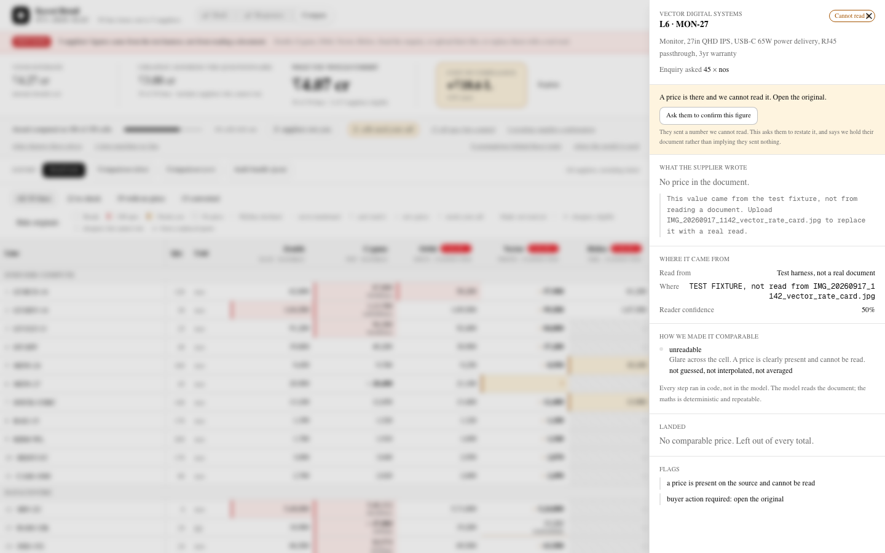
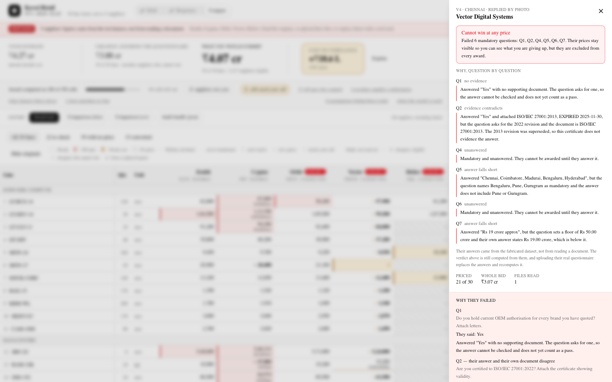
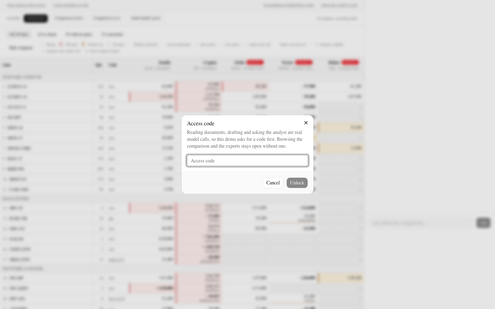

# Kill the Quote Spreadsheet

A buyer talks an RFx into existence, it goes out to suppliers on a channel they choose,
the suppliers reply in whatever shape suits them, and the system reads all of it into one
side-by-side comparison the buyer can interrogate in plain English, all the way to a
defensible award.

An independent product case study in AI-assisted procurement. The demo runs on a fully
**fictional** dataset: thirty line items, a questionnaire, attached documents, and a roster
of ten made-up suppliers of whom five reply. No real company, supplier or price is used.

**Live:** https://kill-the-quote-spreadsheet.vercel.app


*The comparison grid: every price landed in rupees per the asked unit, with off-spec, contested and missing cells marked.*


*Any cell opens its provenance: what the supplier wrote, where it came from, and every step that made it comparable.*


*The supplier panel: each questionnaire verdict with the sentence that produced it, including the expired certificate.*


*On the public demo, every model call asks for an access code first; browsing and exports stay open.*

Screenshots use the fictional dataset loaded through the local test harness, so the "test data" banner is expected. Its totals differ from the live site's: the harness holds every price as typed (cheapest from anyone ₹3.88 cr), while the live site reads the documents and excludes contested photo prices (₹3.91 cr).

## Read these first

| | |
|---|---|
| **[docs/PRD.md](docs/PRD.md)** | One-page PRD: problem, user, goals, non-goals, the AI boundary, metrics and risks. |
| **[WHAT-I-BUILT.md](WHAT-I-BUILT.md)** | The product: the workflow end to end, every feature, and what each ugly edge does. Start here. |
| **[DECISIONS.md](DECISIONS.md)** | The one-page note: what I decided, what I left out, and the better problem. |
| **[AI-MAP.md](AI-MAP.md)** | Every model call, what it is asked, and what it may not do. Six of them. |
| [DECISION-LOG.md](DECISION-LOG.md) | The long version: every decision with its cost, the alternative I rejected, and what I got wrong. |
| [RFX-SETS.md](RFX-SETS.md) | The same four parts in three categories, to show the model is not IT-specific. |

## The problem, requirement by requirement

The requirements I set for the product, checked against the code rather than
asserted. Every row names the file behind it.

| Requirement | Where it lives |
|---|---|
| The buyer **drafts the RFx by conversation** with an AI co-pilot: scope, line items, questionnaire, terms | `lib/copilot.ts`, a real tool loop. Type anything, in any category. The four suggested openers are examples, not paths. |
| The buyer **picks the channel** the RFx goes out on | `api/rfx/send` generates four real documents. The channel is consequential, not a label: WhatsApp cannot carry an attachment, so the pack goes as a link **and a supplier's certificate does not arrive**, which is why their questionnaire answer then has nothing behind it. Your choice at step 3 is the reason step 4 is harder. |
| Suppliers **reply in their own format**, not a buyer template | Five native shapes in `dataset/out`: an xlsx on the supplier's own template, a 3-page PDF, a docx with prices in sentences, a phone photograph, a five-line email. Plus a 31-file stress set: 22 awkward formats (odt, ods, csv, tsv, rtf, txt), 5 photographs of falling quality, and 4 deliberately broken files. |
| **Every** reply is read, whatever its format | `lib/extract/run.ts`. One forced tool, no others. A read that finds nothing **throws** rather than returning an empty column. `npm run sees -- <file>` shows exactly what reaches the model for any file, including yours. |
| One side-by-side comparison with **lines, units and currency aligned** | `lib/normalise.ts`, proven cell-for-cell against an independent Python implementation by 442 assertions. Aliases never change a number, conversions always do, and a conversion with no rule **refuses** instead of guessing. |
| **Questionnaire answers and attachments** shown next to the prices | Both read, both openable. A questionnaire form names a filename and nothing more, so the named document is opened and read **in its own right** and the document governs where the two disagree. Click it in the supplier panel to read the certificate yourself. |
| The buyer **questions the whole comparison** in plain English | `lib/analyst.ts`. Ten tools that compute, no `evaluate`, no SQL, no arithmetic in prose. Tools are bound to the **loaded** enquiry, so a supplier you uploaded is visible to every one of them. |
| Answers come back as **text, tables, charts or exports** | Text and markdown tables. Bar charts, coloured by group, so "who wins each of thirty lines" is one chart. Four exports: award note, xlsx with provenance in cell comments, CSV, and a JSON audit bundle. |
| Analysis runs **on extracted data** and ends in an award the buyer can defend | The award note leads with what the total rests on, why not the cheapest, the assumptions in force, the money deliberately not counted, and who was asked for what and whether they replied. |
| Realistic scale: several suppliers, dozens of lines, a questionnaire, attachments | 30 lines, 10 suppliers of whom 5 reply, 10 questions of which 6 are mandatory, certificates and OEM letters. |
| A fictional dataset a procurement professional would find credible | HSN codes per line, GSTIN and CIN, pack sizes that trap ("kit of 2", "box of 10", "box of 50"), MOQ, ex-works Singapore, a discount buried in footnote 3 on page 3, a prior-PO rate card, and a Rev 2 that supersedes a Rev 1. |
| **The core constraint:** the AI loops are real, and no demo question is answered from a stored answer | Six model call sites, no lookup tables, and **two violations of this found and fixed** rather than avoided. See below. |

**The two violations, because finding them is the point.** The analyst's
questionnaire tool served a `passed` boolean and a hand-typed `finding`
sentence out of `catalog.json`, so the suggested question *"is Vector's ISO
27001 certificate actually valid?"* was answered by handing the model my own
conclusion. And the finding itself did not survive a real read at all: the
revision year and the expiry date live inside an attached PDF that nothing ever
opened. Reading only the form, the honest answer to "does anything contradict
them?" was no, so Vector's six mandatory failures dropped to five and the
screen showed them passing the ISO question. Opening the attachment puts it
back to six, which is what the live site reads today. Both are now derived, and
`regression-test` has three cases pinning the second, including one asserting
that the **form alone must not** produce the finding.

## Run it

```bash
cd web
npm install
cp .env.example .env.local     # add ANTHROPIC_API_KEY
npm run dev
```

No database setup. With `DATABASE_URL` unset it runs embedded Postgres (PGlite) into
`.pglite/`, so the whole app works before anyone has created a cloud database. Set
`DATABASE_URL` to a Neon connection string for production and nothing else changes.

**Without an API key** the calculator, grid, provenance, exports and every award scenario
still work. The three AI loops refuse honestly rather than answering from a lookup table.

**Loading demo data.** A fresh clone starts with an empty comparison. To fill it without a
key, leave `npm run dev` running and, from `web/` in a second terminal, run
`npm run fixture`. That posts to the dev-only `/api/dev/fixture` route, which writes the
shipped quotes (`web/lib/data/raw-quotes.json`) as test-harness cells, each marked
`test_fixture` under a banner that stays until they are gone; `npm run fixture:wipe` removes
them. With a key, `npm run demo:load` instead reads every supplier's real documents through
the model (`-- --dry` shows what it would do first).

## Demo protection

Set `DEMO_ACCESS_CODE` on a public deployment and every route that calls a model (analyst,
co-pilot, extract, inbox) asks for it once, then trusts a signed seven-day cookie. In production
the code also needs `DEMO_COOKIE_SECRET` (32+ characters); without it the unlock and every model
route answer 503 rather than sign with a weak key. Browsing the grid and the exports needs no
code. Usage is counted in model calls, in Postgres: each request is charged the most calls it can
make (an analyst question 12, a co-pilot message 8, an upload one per file, an inbox delivery one
per document), against `DEMO_RATE_LIMIT` per IP per 10 minutes (default 60) and
`DEMO_DAILY_CALL_CAP` per UTC day across everyone (default 300). Requests that fail cheap checks
(uploads over 15 MB or 40 files, a conversation over 40 messages or 60,000 characters, a message
over 8,000 characters) are refused with 413 before any allowance is spent. Off Vercel the
forwarded-IP headers can be spoofed, so the daily cap is the real backstop. Everything lives in
`web/lib/demo-guard.ts`; see `web/.env.example`.

## Two loops, one rule

The model reads two kinds of document, and the split is the same in both:

| | The model reports | Code decides |
|---|---|---|
| **A quotation** | the number, in the supplier's own unit and currency | landed cost, in the asked unit, in rupees |
| **A questionnaire** | the answer, what they attached, and what the attachment *says* | whether that satisfies the question |

The second one is worth a sentence. A supplier answers *"Yes, we are ISO 27001
certified"* and attaches a certificate that expired and names the withdrawn 2013
revision. The answer and its own evidence disagree. A model asked "did they
pass?" might well say yes, because they said yes. Comparing a date to today is
not a judgement call, so code does it, and every verdict carries the sentence
that produced it.

There are three qualification states, not two: passed, failed, and **not assessed**.
The third is the one that matters, because without it a screen can claim a
failure it has no evidence for.

## The one rule

The constraint I held the build to: delivery plumbing may be stubbed, but reading,
reasoning and answering must be real model calls, and no demo question may be answered
from a stored answer.

- **Stubbed:** the delivery hop only. The four enquiry documents are really generated.
- **Real:** drafting, reading and answering are model calls. Extraction is cached on
  `(model, prompt hash, file hash)`, so change one byte of a document or one word of the
  prompt and it genuinely re-reads.
- **Nothing hardcoded, and each of these was once false.** Zero branches on question
  text or on a drafting message. Zero hardcoded amounts. No arithmetic rule keyed to a
  supplier code or a line number. No stored qualification verdict, and no analyst tool
  reading one: the tool that answers *"is Vector's ISO 27001 certificate actually
  valid?"* used to serve a `passed` boolean and a `finding` sentence out of
  `catalog.json`, which is exactly the shortcut this project rules out. Every one of these
  now has a regression test, because each was found rather than avoided.
- **Two branches on a filename, both deliberate.** Which supplier sent an unrecognised
  file, and whether a document is a questionnaire rather than a quotation. Both are
  hints that fail safe: the first refuses and asks rather than guessing, and the second
  is recoverable because a quotation read as a questionnaire returns no answers and
  throws loudly.
- **Your data, not the shipped data.** Draft any enquiry, invite any subset of the
  roster, upload a quotation from a company that appears nowhere in this repository:
  it gets its own column, is marked *not assessed*, can be chased, is visible to every
  analyst tool, and lands in the award note. Seven end-to-end cases cover exactly this,
  because the property worth protecting is not that the demo works but that the demo is
  not the only thing that does.

The AI reads. The code counts. Two independent implementations of the calculator, one in
Python and one in TypeScript, are proven to agree on all 150 cells.

## Tests

```bash
cd web
npm run test:all            # ten offline suites: calculator, readers, parser, revisions, generality, questionnaire, contrast, cache, regressions, demo guard
npm run dev                 # then, in another shell:
python3 scripts/demo-test.py    # ten walkthrough claims against the requirements
python3 scripts/e2e-test.py     # happy and sad paths over real HTTP
npm run accuracy            # needs a key: is the reading actually right?
```

`npm run verify` is everything that costs nothing: types, lint, and the ten
offline suites in `npm run test:all`.

| Suite | Checks | Key |
|---|---|---|
| `conformance` | 442 assertions: two independent calculators agree on all 150 cells | no |
| `reader-test` | 47 cases: every format plus all 11 photographs, and 4 broken files (3 refused with instructions, 1 truncated PDF correctly routed to vision) | no |
| `parse-check` | 10 realistic model output shapes: omitted nulls, invented line numbers | no |
| `revision-test` | A replaced quotation resolves, reports what moved, and re-reads the same | no |
| `generality-test` | The product runs on an enquiry in a category it has never seen | no |
| `questionnaire-test` | 16 cases. An expired certificate, a superseded standard, a threshold missed, somebody else's certificate: caught, each saying why, and the case that only works because the ATTACHMENT is opened | no |
| `contrast-test` | Every colour that carries meaning against its WCAG floor, both themes, oklch maths validated against a real browser first | no |
| `cache-test` | The extraction cache stores, returns, and misses for the right reasons | no |
| `sees` | What actually reaches the model for any document you give it | no |
| `regression-test` | 69 cases: bugs that actually shipped cannot come back unnoticed | no |
| `guard-test` | 15 cases: access code, signed cookie, per-IP limit, daily cap, oversized requests refused before any spend | no |
| `e2e-test` | 42 cases over HTTP, mostly sad paths, including a newcomer's own file | yes |
| `accuracy` | Recall, price exactness, unit correctness, invention rate, and whether **confidence falls when accuracy falls** | yes |
| `api-check` | Whether the model is reachable, and which of the three ways a key can be dead this is. Two tokens | yes |
| `doc-numbers` | Prints every figure the documents claim, from the calculator. Run before editing a number in any doc | no |

## Layout

```
dataset/generators/   the fabricated corpus, and normalise.py: the REFERENCE calculator
dataset/out/          five supplier replies in five shapes, and a 31-file stress set
web/lib/normalise.ts  the TypeScript calculator, proven against the Python one
web/lib/extract/      readers per format, the extraction contract, the reader loop
web/lib/chase.ts      what each supplier still owes, and how to ask for only that
web/lib/questionnaire.ts  whether an answer holds, and the sentence that says why
web/app/api/rfx/inbox/    replies arriving: transport stubbed, reading real
web/scripts/          every test suite
```

`dataset/out/99-internal/ground-truth.json` is an oracle. The running app must never read
it; it exists to score extraction accuracy and to prove the demo is not scripted.
