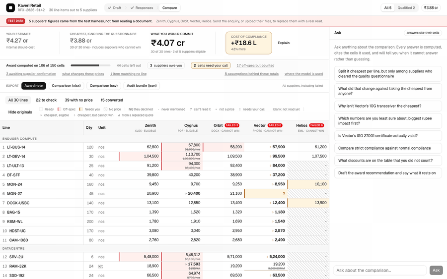

# Kill the Quote Spreadsheet

Suppliers reply to an RFx as spreadsheets, PDFs, emails and phone photos, and someone retypes it all into one sheet before anyone can compare a price.

**Live demo:** https://kill-the-quote-spreadsheet.vercel.app (browsing and exports are open; model calls need an access code from the author). All data is fictional.



> [!NOTE]
> **Evals.** Fictional corpus: 5 supplier replies in 5 formats (107 priced lines) and 5 photos of one rate card.
>
> | Measure | Result |
> |---|---|
> | Priced lines read exactly, price and unit | **107 / 107** |
> | Prices invented for lines the supplier never priced | **0** |
> | Hardest photo (low light), read exactly | **7 / 21**, every wrong price at confidence 0.55 or below and flagged in the UI |
>
> **Held-out check** (5 new fictional supplier replies in all 5 formats, 6 inputs with one sheet photographed twice, 77 priced lines, key committed before any model call, code frozen, 3 runs): **0 invented** in every run; spreadsheet, PDF, Word, email and a moderate photo read **exactly in all 3 runs**; the very hard low-light photo read 10, 8 and 10 of 15 exactly, every wrong price at confidence 0.70 or below and flagged in the UI. Overall **71.3 / 77 (93%)** exact.
>
> Caveat: fictional data; run through the Claude Code CLI, not the production API path; the 107 / 107 above is on the corpus the two reader fixes came from; the held-out key was written by the author. Method and every miss: [EVALS.md](EVALS.md).

## Why AI here, why code there

A model is used only where the input is free-form language or images. Anything that must
be exact and repeatable is ordinary code. The full list is in [AI-MAP.md](AI-MAP.md).

| Step | Done by | Why |
|---|---|---|
| Draft the RFx from a conversation | Model (`lib/copilot.ts`) | Turning "200 laptops for three offices" into lines and questions is language work. It has no price field, so it cannot invent one |
| Read each quotation, in any format | Model (`lib/extract/run.ts`) | Formats are unbounded (a photo, a price in a sentence), so rules cannot read them. It reports numbers as written and converts nothing |
| Second read of the 8 largest prices on a photo | Model, cheaper tier, shown only the crop | Its value is independence. If the two reads disagree, code removes the price from every total |
| Read questionnaire answers and attached certificates | Model (`lib/extract/questionnaire.ts`) | It reports what each document says and returns no verdict |
| Units, currency, landed cost, totals, award scenarios | Code (`lib/normalise.ts`) | Must give the same answer every time; two independent implementations agree on all 150 cells |
| Pass or fail on each question, and what each supplier still owes | Code (`lib/questionnaire.ts`, `lib/chase.ts`) | Comparing an expiry date to today is not a judgement call, and a model may echo the supplier's "yes" |
| Answer the buyer's questions | Model chooses among 10 calculator tools (`lib/analyst.ts`) | Language in, language out. Every number comes from a tool; there is no tool that does free arithmetic |

## Quick start

```bash
cd web && npm install
cp .env.example .env.local     # add ANTHROPIC_API_KEY (optional: the calculator, grid and exports work without it)
npm run dev                    # then `npm run fixture` in a second terminal to load demo data
```

## More

- [docs/PRD.md](docs/PRD.md): one-page PRD: problem, user, goals, non-goals, the AI boundary, metrics and risks.
- [WHAT-I-BUILT.md](WHAT-I-BUILT.md): the product: the workflow end to end, every feature, and what each ugly edge does. Start here.
- [DECISIONS.md](DECISIONS.md): the one-page note: what I decided, what I left out, and the better problem.
- [AI-MAP.md](AI-MAP.md): every model call, what it is asked, and what it may not do. Six of them.
- [EVALS.md](EVALS.md): eval method, results and every miss.
- [DECISION-LOG.md](DECISION-LOG.md): the long version: every decision with its cost, the alternative I rejected, and what I got wrong.
- [RFX-SETS.md](RFX-SETS.md): the same four parts in three categories, to show the model is not IT-specific.
- [docs/DESIGN-NOTES.md](docs/DESIGN-NOTES.md): screenshots, and every requirement checked against the code.
- [docs/ARCHITECTURE.md](docs/ARCHITECTURE.md): the two loops, the one rule, and the repo layout.
- [docs/SETUP.md](docs/SETUP.md): full setup, demo protection, and every test suite.

## License

[MIT](LICENSE) © 2026 Avinash Gaurav.
